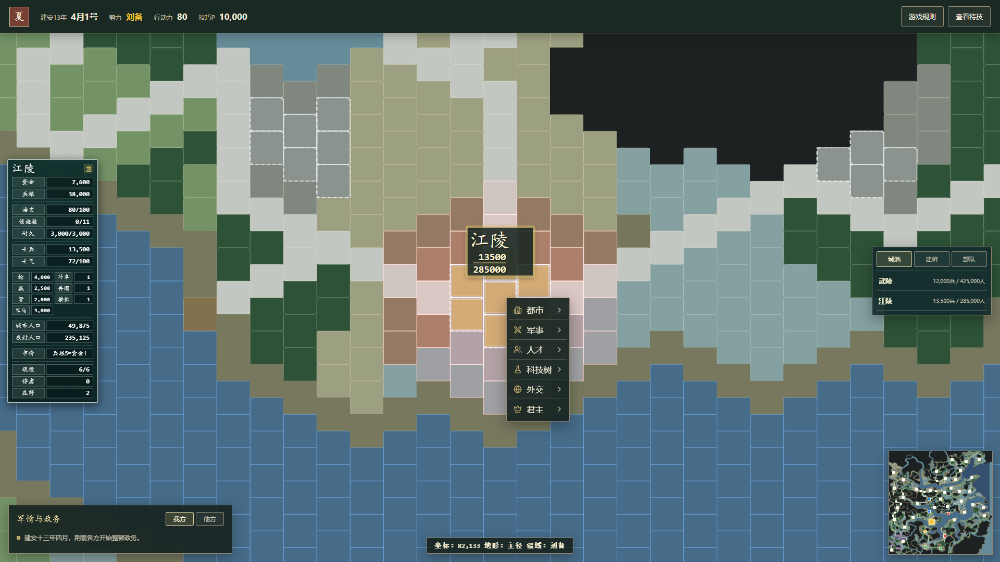

# 建安十三年：荆襄争夺

三国志 11 风格的**网页回合制策略游戏**。从 208 年荆襄一隅起兵，在 24 个月内经营城池、调兵遣将，争夺天下。支持单机与联网对战。



## 特点

- **回合制经营**：一个月分上、中、下旬，一局共 72 旬。每旬分配行动力（默认 80）用于征兵、开发、训练、研究、外交、登庸等城市指令。
- **战棋战斗**：错列方格地图，逐格移动。普攻、齐攻、战法（18 种）、计略（7 种）、单挑（4 种架式 + 怒气）、舌战。
- **武将体系**：统率 / 武力 / 智力 / 政治 / 魅力五维，6 个兵种的适性（S++ ~ C），89 种特技，20 件宝物，以及忠诚、相性、义理、野心、伤病等关系网。
- **科技树**：9 大系统 × 6 级共 73 个节点，以「技巧 P」为货币，解锁设施档次、战法威力与兵装。
- **委任系统**：给部队下达移动 / 建设 / 修补委任，点「进行」时自动寻路执行。
- **大地图**：内置 200×200 格「华夏 42 城」全图，另有 8 城荆襄经典剧本。
- **地图编辑器**：自制地图，可设置城池与关隘归属、手动圈定建设用地（或一键自动圈地）、为指定势力放置军事设施。
- **联网对战**：Socket.IO 房间制，服务端持有权威游戏状态。

## 快速开始

需要 **Node.js 22 或更高版本**（后端使用 `node:sqlite`）。

```bash
npm install
npm run dev
```

浏览器打开 http://localhost:5173 即可单机游玩。

联网对战需额外启动后端：

```bash
npm run server        # 默认 8787，可用 PORT / CORS_ORIGIN 环境变量覆盖
```

Windows 上也可直接双击 `start-dev.bat`，它会开两个窗口把前后端一起拉起（前端 5174），启动前先清理 8787 / 5174 端口上的旧进程。

## 常用命令

| 目的 | 命令 |
| --- | --- |
| 前端开发服务器 | `npm run dev` |
| 联网后端 | `npm run server` |
| 类型检查 + 构建 | `npm run build`（= `tsc --noEmit && vite build`） |
| 全部单元测试 | `npm test`（Vitest，96 个测试文件） |
| 单个测试文件 | `npm test -- src/game/random.test.ts` |
| 只跑客户端 / 服务端 | `npx vitest run --project client` / `--project server` |
| 端到端测试 | `npm run test:e2e`（Playwright，三档视口） |
| 单个 e2e | `npx playwright test e2e/game.spec.ts --project=desktop-1440` |
| 重新生成华夏地图 | `npm run map:china` |

## 项目结构

```
src/
  game/            规则层（纯函数，不依赖 React）
    battle/        移动、ZOC、战斗、战法、计略、委任、设施、补给
    skills/        武将特技系统（定义 / 持有者 / 按域应用 / 复杂连锁）
    scenario/      剧本与地图数据
    map-editor/    地图编辑器逻辑与地图生成器
    network/       GameIntent 协议与归约
    store/         React 状态容器
  components/      界面层
server/            联网后端（Socket.IO + node:sqlite）
e2e/               Playwright 端到端测试
docs/              规则文档与设计文档
scripts/           一次性逆向 / 校验脚本（不参与构建）
```

## 架构

玩家点击、AI、联网对手**三条路径收敛到同一条规则链路**，规则只实现一次：

```
UI(GameShell) / AI(ai.ts) / 服务端(RoomManager)
  → GameIntent          src/game/network/intents.ts
  → reduceGameIntent    src/game/network/intentReducer.ts
  → battle/* 与 commands.ts / turn.ts
  → 新的 GameState
```

几个关键约定：

- `GameState` 按**不可变数据**处理（手动 `structuredClone` 后修改再返回），不要就地改传入的 state。
- `battle/` 与 `skills/` 下**不允许引入** React、socket.io 等，模块边界由 `battle/module-boundaries.test.ts` 强制。
- 新增玩法要同时接三处：`intents.ts` 的 intent 类型、`intentReducer.ts` 的分支、`events.ts`（若需要音效/动画表现事件）。
- 同一数值或公式只允许一个导出，UI 悬浮提示与引擎结算必须共用同一个函数。

更完整的模块地图、跨文件不变量与测试须知见 [CLAUDE.md](CLAUDE.md)。

## 规则文档

- [`docs/GAME_RULES.md`](docs/GAME_RULES.md) —— 完整规则
- 游戏内的「游戏规则」弹窗（`src/components/gameRulesContent.ts`）是同一份规则的另一个载体，改规则时**两处要同步**
- [`docs/damage-formula.html`](docs/damage-formula.html) 与 [`docs/damage-simulator.html`](docs/damage-simulator.html) 是伤害公式的离线演算页

## 许可证与素材声明

**代码**以 [MIT 许可证](LICENSE)授权，可自由使用、修改、分发与商用。

**但仓库中的部分美术与音效素材不在 MIT 授权范围内**，详见 [NOTICE](NOTICE)：

- `assets/image/avatar/*.bmp`
- `assets/sound/debate/*.mp3`、`assets/sound/menu/*.mp3`、`assets/sound/troops/*.mp3`
- `public/assets/jingxiang-map.png`

上述素材的著作权归 **Koei Tecmo Games（光荣特库摩）** 所有，仅作为个人学习与技术演示用途包含在仓库中，**不得用于商业用途，亦不得再分发**。

如需在商业或公开发行场景使用本项目，请自行移除这些素材并替换为拥有合法授权的资源。

## 免责声明

本项目是参考《三国志11》制作的**非官方爱好者作品**，在题材与人物设定上借鉴原作。与 Koei Tecmo Games 无任何关联，未获其授权或认可。「三国志」「三国志11」等名称与相关商标归其各自权利人所有。
